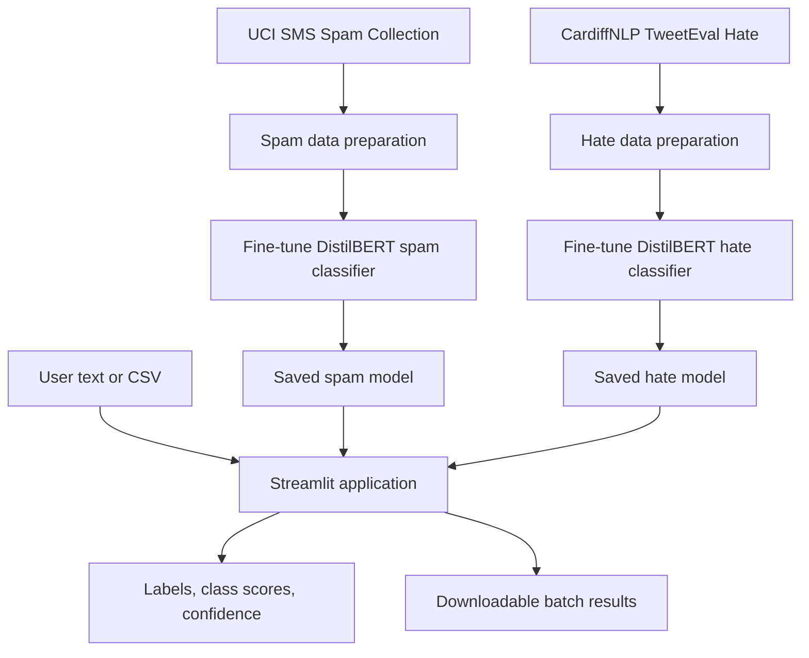

# Project report: AI-based spam and hate speech detection

## Abstract

This project implements two independent binary text-classification pipelines: (1) SMS spam detection and (2) hate speech detection. Each pipeline fine-tunes a DistilBERT language model on a task-specific dataset, evaluates it with class-sensitive metrics, and exposes predictions through a Streamlit web interface. The interface supports manual messages, CSV batch inference, threshold adjustment, and scenario-based testing.

## Problem statement

Unwanted promotional or fraudulent messages and hateful online content create different moderation problems. Traditional keyword filters are brittle, while transformer encoders can use surrounding word context. However, context-sensitive labels and imbalanced data require careful validation, clear thresholds, and human oversight.

## Objectives

- Prepare two public English-language text datasets.
- Fine-tune a pretrained transformer for each binary classification task.
- Evaluate models with precision, recall, F1, macro-F1, accuracy, and confusion matrices.
- Build a browser-based Streamlit interface for single and batch prediction.
- Test ordinary, obvious, edge, and context-sensitive inputs.
- Document limitations, data attribution, and responsible use.

## System architecture



## Dataset design

### Spam dataset

UCI SMS Spam Collection: 5,574 English messages labeled ham or spam. The project maps `0 = ham` and `1 = spam`, removes exact duplicates and blank messages, then performs a stratified 80/10/10 train/validation/test split.

### Hate speech dataset

CardiffNLP TweetEval `hate` configuration: English tweets labeled `0 = non-hate` and `1 = hate`. The project keeps the official train, validation, and test splits.

See [DATASETS.md](DATASETS.md) for sources and usage notes.

## Model methodology

Both models use the same pretrained base (`distilbert-base-uncased`) but are trained independently. Text is tokenized with truncation and a 192-token maximum length. The output layer has two classes. Class-weighted cross-entropy helps account for class imbalance, and validation F1 selects the best epoch checkpoint.

## Evaluation methodology

The primary positive-class metrics are precision, recall, and F1. Macro-F1 and accuracy provide additional views. The confusion matrix helps distinguish false positives from false negatives. Spam accuracy is not sufficient because the dataset is imbalanced. For hate speech, false positives on counterspeech or neutral identity mentions deserve explicit review.

The training script writes results to each model's `evaluation_metrics.json`. No scores are claimed in this report because they must be generated in the user's environment after training. Model quality depends on the downloaded dataset version, hardware, randomization, and training configuration.

## Application features

- Single text analysis by either task or both tasks.
- Adjustable independent positive-class thresholds.
- Confidence and both class probabilities.
- CSV upload and downloadable annotated output.
- Scenario lab with ordinary, spam, hate, counterspeech, ambiguous, and domain-shift cases.
- Model readiness indicators and display of saved test metrics.
- Explicitly labeled demo-only fallback when trained model files are absent.

## Execution

```bash
pip install -r requirements.txt
python -m src.train --task all --epochs 3
streamlit run app.py
```

For detailed setup and test instructions, see [MODEL_TRAINING.md](MODEL_TRAINING.md), [USER_GUIDE.md](USER_GUIDE.md), and [TEST_PLAN.md](TEST_PLAN.md).

## Conclusion

The project demonstrates a complete NLP workflow from data acquisition and preparation through transformer fine-tuning, evaluation, inference, and a usable web interface. It is an educational starting point. Before real-world deployment, it requires domain-specific datasets, robust bias and error analysis, privacy safeguards, threshold validation, and human review.
